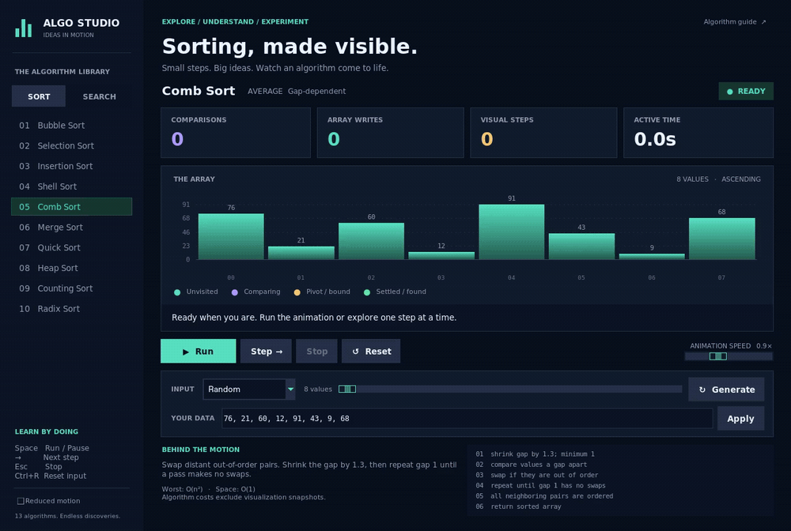

<div align="center">

# ⚡ ALGO STUDIO

### Algorithms have moves. Now you can see them. 🪄

**A tiny Python playground with a big personality.**<br>
Turn “wait, how does that work?” into “ohhh, I get it.”


[🎮 Press play](#press-play) · [🧠 Meet the algorithms](#the-lineup) · [🎛️ Take control](#the-controls) · [🧪 Try a challenge](#challenge-mode)

</div>



<p align="center"><sub>🎬 Actual app footage. Dark → Light → Dark. Comb → Shell → Interpolation. A little glass, a lot of motion.</sub></p>

---

## ✨ A little less textbook. A lot more “aha!”

| 🕺 Watch the moves | 🔍 Catch every detail | 🎨 Make it yours |
| :--- | :--- | :--- |
| Bars glide through swaps on curved paths. Writes ease into place. Active values glow. | Live comparisons, array writes, highlighted pseudocode, and a description of every step. | Custom arrays, four data presets, adjustable speed, and your own search target. |
| Finish a sort and enjoy the green sweep + sparkle moment. ✨ | Pause, step forward, hover over a bar, and inspect exactly what's happening. | Negatives? Zeros? Duplicates? Bring them. Reduced motion is one click away. |

> 💡 **The best part:** you can stop an algorithm halfway through without breaking anything. Your original input comes right back. No restart ritual required.

> ✨ **[Fresh moves · v2.1.1](https://github.com/Rad-Sharkboy/Algorithm-Visualizer/releases/tag/v2.1.1):** clearer sorting steps, recursive Quick/Merge Sort, and stable digit-counting Radix Sort. Follow every comparison, shift, and swap as it happens.

<details>
<summary><strong>🌓 Meet the glow-up: daylight, midnight, and a little liquid glass</strong></summary>

<br>

| ☀️ Light | 🌌 Dark | 🪟 System |
| :--- | :--- | :--- |
| Frosted surfaces, inky text, and jewel-tone bars. | Midnight panels, mint highlights, and soft reflections. | Follows Windows' **app color mode**, including changes while the studio is open. |

Choose **System / Light / Dark** beside the title. Windows changes are picked up within about two seconds. On other systems, or when the Windows preference cannot be read, System uses Dark; you can always choose Light manually. Switching keeps your animation, input, focus, and open guide intact.

**The play button got dressed up.** A rounded glass surface, a traveling reflection, a press ripple, and a play icon that morphs into pause. Keyboard focus gets its own outline; <kbd>Space</kbd> or <kbd>Enter</kbd> activates the focused control. The matching Reduced motion pill switches the decorative effects off.

**Fonts already living on your computer:** Segoe UI Variable / Segoe UI on Windows, SF Pro Text / Helvetica Neue when available on macOS, and Noto Sans / DejaVu Sans elsewhere. Code and values use installed coding fonts such as Cascadia, Consolas, or Menlo, with system fallbacks. No font files. No downloads. 🪄

<sub>The glass is drawn in Tkinter, including its reflections; it does not blur other windows or require a compositor extension.</sub>

</details>

<a id="press-play"></a>

## 🎮 Three commands. You're in.

You'll need **Python 3.10+**, **Tkinter**, and a graphical desktop. No pip shopping list.

```bash
git clone https://github.com/Rad-Sharkboy/Algorithm-Visualizer.git
cd Algorithm-Visualizer
python3 PROJECT.py
```

On Windows, `py PROJECT.py` works too. Not sure whether Tkinter is available? Run `python3 -m tkinter`—a little demo window means you're good to go.

**Pick an algorithm → choose your data → hit Run → follow the glow.**

<a id="the-lineup"></a>

## 🧠 Meet the lineup

### 🏁 The sorting crew

| Algorithm | Its whole personality |
| :--- | :--- |
| 🫧 **Bubble Sort** | One neighbor at a time. Patiently. Very patiently. |
| 🎯 **Selection Sort** | Find the smallest. Give it the front seat. |
| 🃏 **Insertion Sort** | Organize the array like a hand of cards. |
| 🐚 **Shell Sort** | Start with giant steps, then mind the gaps. |
| 🪮 **Comb Sort** | Detangle the array with a shrinking comb. |
| 🧩 **Merge Sort** | Tiny sorted teams join forces until everyone's in order. |
| ⚡ **Quick Sort** | Pick a pivot. Everyone chooses a side. Repeat. |
| 🏔️ **Heap Sort** | The biggest value keeps getting promoted to the end. |
| 🧮 **Counting Sort** | Keep a tally, then rebuild the lineup. |
| 📬 **Radix Sort** | Count each digit, build its output, and move to the next place. |

### 🕵️ The search squad

| Algorithm | How it finds the suspect |
| :--- | :--- |
| 🚶 **Linear Search** | Knock on every door until the target answers. |
| ✂️ **Binary Search** | Rule out half the street with every decision. |
| 📍 **Interpolation Search** | Estimate the address from the values at either end. |

> 📌 **Search rules:** indices start at zero. Linear Search returns the **first matching index**. Binary and Interpolation Search stop at the match they encounter; with duplicates, that may be a later occurrence. They sort a copy first, so their result indices refer to that sorted copy. The app tells you when it does this. Reset restores your original order.

<details>
<summary><strong>🤓 Open the nerd drawer: complexity, gap sequences, and the fine print</strong></summary>

<br>

| Algorithm | Average time | Worst time | Extra space |
| :--- | :---: | :---: | :---: |
| Bubble Sort | O(n²) | O(n²) | O(1) |
| Selection Sort | O(n²) | O(n²) | O(1) |
| Insertion Sort | O(n²) | O(n²) | O(1) |
| Shell Sort | Gap-dependent | O(n²) | O(1) |
| Comb Sort | Gap-dependent | O(n²) | O(1) |
| Merge Sort | O(n log n) | O(n log n) | O(n) |
| Quick Sort | O(n log n) | O(n²) | O(n) |
| Heap Sort | O(n log n) | O(n log n) | O(1) |
| Counting Sort | O(n + k) | O(n + k) | O(k) |
| Radix Sort | O(d · n) | O(d · n) | O(n) |
| Linear Search | O(n) | O(n) | O(1) |
| Binary Search | O(log n) | O(log n) | O(1) |
| Interpolation Search | O(log log n)* | O(n) | O(1) |

- **n** = number of values, **k** = integer range, **d** = base-10 digit count.
- **Shell** uses the original halving gaps: `n // 2, …, 1`. **Comb** shrinks its gap by 1.3 and finishes only after a gap-1 pass makes no swaps.
- **Selection** performs its two array assignments every pass, even when the minimum is already in place; these still count as writes.
- **Quick** uses the final value as pivot, scans inward from both sides, and recursively sorts the partitions. **Merge** recursively splits the array, then joins halves using two temporary arrays.
- **Radix** uses ten digit counts, cumulative totals, and a right-to-left output pass before copying back. Each pass multiplies the digit place by ten. Negative keys use an offset; **Counting** also supports negative integers.
- **Interpolation's average** assumes uniformly distributed, distinct keys. Skewed data can take linear time. Equal endpoints are handled without dividing by zero.
- Costs above describe the algorithms. Copying visual frames, storing the original input, and drawing the chart add overhead. Sorting a search input is preparation, excluded from search comparison/write counts.

</details>

<a id="the-controls"></a>

## 🎛️ You're the director

| Control | What happens |
| :--- | :--- |
| ▶️ **Run / Pause / Resume** | Let it move. Freeze the action. Keep going. |
| 👣 **Step** | Inspect one exact algorithm snapshot at a time. |
| 🛑 **Stop** | Cancel the run and rescue your original input. |
| ↩️ **Reset** | Same data, fresh counters, clean slate. |
| 🔁 **Replay** | Give the original array another round. |
| 🎲 **Generate** | Random, nearly sorted, reversed, or just a few unique values. |
| ✍️ **Apply** | Use your own comma- or space-separated integers. |
| 🏎️ **Animation speed** | Change the pace—even during a run. |
| 🌙 **Reduced motion** | Keep the learning; skip the decorative movement. |
| 🌓 **Theme** | Choose Light, Dark, or the Windows-following System mode without interrupting playback. |
| 📖 **Algorithm guide** | Open the explanation, pseudocode, and complexity. |

**Input playground:** generated arrays have **8–64 values**. Custom arrays accept **1–64 integers from −999 to 999**. Hover over any bar for its index and exact value.

<details>
<summary><strong>⌨️ Keyboard cheat sheet — mouse optional</strong></summary>

<br>

| Key | Action |
| :---: | :--- |
| <kbd>Space</kbd> | Run / Pause / Resume |
| <kbd>→</kbd> | Next step |
| <kbd>Esc</kbd> | Stop |
| <kbd>Ctrl</kbd> + <kbd>R</kbd> | Reset |
| <kbd>Enter</kbd> in **Your Data** | Apply the array |
| <kbd>Enter</kbd> in **Target** | Run the search |

Typing and cursor movement still work normally in input fields. Focused buttons keep their standard Space activation.

</details>

<details>
<summary><strong>🌈 Decode the glow & the numbers</strong></summary>

<br>

| Color | Meaning |
| :--- | :--- |
| 🩵 Teal | Unvisited |
| 💜 Purple | Being compared or written |
| 💛 Amber | Pivot or search boundary |
| 💚 Green | Settled value or search match |
| 🩶 Muted gray | Eliminated search position |

Every step also has a text description. Found it? Missed it? Finished sorting? You'll get an explicit message.

- **Comparisons:** value comparisons made by the algorithm.
- **Array writes:** assignments to the main array; a swap counts as two. Auxiliary buffers and buckets are excluded.
- **Visual steps:** displayed algorithm snapshots, including explanation and completion frames. Animation in-between frames do not inflate this count.
- **Active time:** animation time excluding pauses. This is a learning tool, not a stopwatch benchmark.

</details>

<a id="challenge-mode"></a>

## 🧪 Tiny challenges. Big brain energy.

| Mission | Try this |
| :--- | :--- |
| 🪮 **The long-distance swap** | Paste `76, 21, 60, 12, 91, 43, 9, 68`, choose **Comb Sort**, and watch distant bars trade places. |
| 🐚 **Mind the gap** | Replay that same input with **Shell Sort**. Spot the moment the gap becomes 1. |
| 👯 **The duplicate detective** | Paste `9, -4, 9, 0, -4, 12`, search for `-4`, and compare Linear with Interpolation. Why are the indices different? |
| 🫧 **Bubble's easy day** | Generate a nearly sorted array. Compare Bubble's counts with a reversed input of the same size. |
| 🧊 **Freeze frame** | Pause a merge, press Step, and explain the next write before it happens. |

<details>
<summary><strong>🛠️ Peek under the hood</strong></summary>

<br>

```text
Algo Studio
├── PROJECT.py          🎛️ Interface + animation controller
├── algorithms.py       🧠 13 incremental algorithms
├── motion.py           🕺 Easing, colors + swap trajectories
├── datasets.py         🎲 Presets + input validation
├── theme.py            🎨 Palette, fonts + widget styling
├── docs/               🎬 The actual app demo
└── tools/record_demo.py 📹 Demo recorder
```

Tk's event loop keeps animations responsive without worker threads or blocking sleeps. Changing data, switching algorithms, resetting, or closing the window cancels pending callbacks. Stop restores the original values because shifting and merging can temporarily overwrite array positions.

Pausing settles the current visual transition. Single-step shows an exact snapshot. Very fast playback skips transitions to keep up; reduced motion disables transitions and completion effects entirely.

The layout supports windows from **1000 × 740**. On shorter windows, inline notes tuck away; **Algorithm guide** stays available. Importing the modules does not launch the app.

</details>

---

<div align="center">

### 💭 Read the idea. Predict the next move. Press play.

**Made for the moment when the algorithm finally clicks.** ✨

</div>
