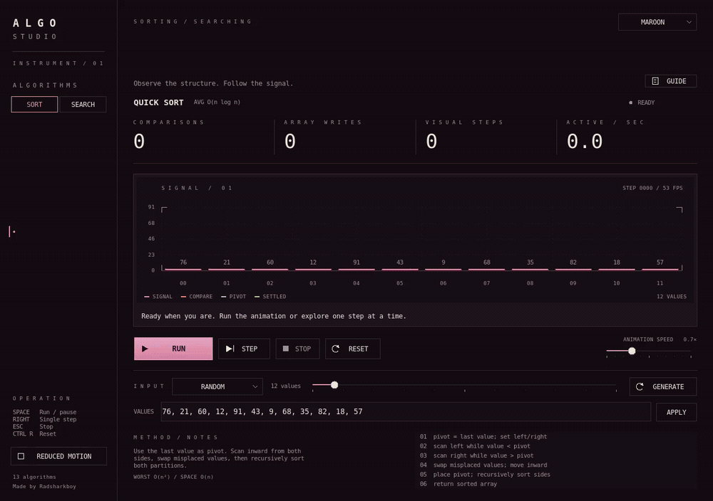

<div align="center">

# ⚡ ALGO STUDIO

### Algorithms have moves. Now you can see them. 🪄

**A tiny Python playground with a big personality.**<br>
Turn “wait, how does that work?” into “ohhh, I get it.”


[🎮 Press play](#press-play) · [🧠 Meet the algorithms](#the-lineup) · [🎛️ Take control](#the-controls) · [🧪 Try a challenge](#challenge-mode)

</div>



<p align="center"><sub>🎬 Actual app footage. Five palettes, animated signal columns, and sorting and searching in motion.</sub></p>

---

## ✨ Visualize each step

| Playback | Inspection | Customization |
| :--- | :--- | :--- |
| Animated swaps, value writes, and completion highlights make each operation visible. | Track comparisons, array writes, highlighted pseudocode, and an explanation of every step. | Enter custom arrays, choose from four presets, adjust playback speed, and set search targets. |
| Pause, resume, or advance one step at a time. | Hover over a bar to inspect its index and value. | Five palettes and automatic System mode, with optional Reduced motion. |

Stopping a run restores the original array. Negative integers, zeros, and duplicate values are supported.

> **[v3.0.0 · In Full Color](https://github.com/Rad-Sharkboy/Algorithm-Visualizer/releases/tag/v3.0.0)** — a new console, five palettes, and a theme that remembers you. [Short changelog →](docs/releases/v3.0.0.md)

<details>
<summary><strong>🌓 Appearance and accessibility</strong></summary>

<br>

| Palette | Character |
| :--- | :--- |
| **[Phosphor](docs/phosphor.png)** | Warm black, amber signal columns, coral comparisons, cyan pivots. |
| **[Paper](docs/paper.png)** | Cream surfaces, deep ink columns, and amber controls. |
| **[Red](docs/red.png)** | Scarlet gradients fading into wine. |
| **[Maroon](docs/maroon.png)** | Rose gradients fading into mulberry. |
| **[Purple](docs/purple.png)** | Mauve gradients fading into aubergine. |

Choose a palette or **System** beside the title. Your choice is saved automatically for the next launch. System follows Windows' app color preference, including changes while the app is open; elsewhere it uses Phosphor. Switching palettes preserves playback, input, and open guides.

Only the theme choice is saved, in your account's `AlgoStudio/preferences.json`: under `%APPDATA%` on Windows, `~/Library/Application Support` on macOS, or `$XDG_CONFIG_HOME` / `~/.config` on Linux. Missing or unreadable settings fall back to System. No input arrays are saved.

The footer links back to the project through **Made by Radsharkboy**. The Run button has a drawn play/pause icon. Sliders have rounded handles and support dragging, track clicks, and keyboard adjustment. Focused controls have a visible outline. **Reduced motion** removes spatial and decorative movement while retaining a brief color fade and every algorithm step.

**Installed fonts:** the display title uses Georgia, Cambria, Palatino, or an installed serif fallback. Labels, values, code, and counters use Consolas, Menlo, DejaVu Sans Mono, or a system monospace fallback. No font downloads, runtime images, or pip packages are needed.

</details>

<a id="press-play"></a>

## 🎮 Getting started

Requires **Python 3.10+**, **Tkinter**, and a graphical desktop. No pip dependencies are required.

**Download [Algo-Studio-v3.0.0.py](https://github.com/Rad-Sharkboy/Algorithm-Visualizer/raw/refs/tags/v3.0.0/builds/Algo-Studio-v3.0.0.py)** and run `py Algo-Studio-v3.0.0.py` on Windows or `python3 Algo-Studio-v3.0.0.py` on macOS/Linux. The single file includes the whole app. A [portable ZIP](https://github.com/Rad-Sharkboy/Algorithm-Visualizer/raw/refs/tags/v3.0.0/builds/Algo-Studio-v3.0.0.zip) is also available; extract it before running. [SHA-256 checksums](https://github.com/Rad-Sharkboy/Algorithm-Visualizer/raw/refs/tags/v3.0.0/builds/SHA256SUMS) are provided with the release.

Or run the source checkout:

```bash
git clone https://github.com/Rad-Sharkboy/Algorithm-Visualizer.git
cd Algorithm-Visualizer
python3 PROJECT.py
```

On Windows, use `py PROJECT.py`. To check whether Tkinter is available, run `python3 -m tkinter`; a small demonstration window should open.

**Select an algorithm → configure the input → press Run → inspect each step.**

<a id="the-lineup"></a>

## 🧠 Algorithm library

### Sorting

| Algorithm | Approach |
| :--- | :--- |
| 🫧 **Bubble Sort** | Compare adjacent values and swap pairs that are out of order. |
| 🎯 **Selection Sort** | Select the minimum remaining value and place it at the next position. |
| 🃏 **Insertion Sort** | Insert each value into the sorted portion of the array. |
| 🐚 **Shell Sort** | Apply insertion sort across progressively smaller gaps. |
| 🪮 **Comb Sort** | Compare and swap values separated by a shrinking gap. |
| 🧩 **Merge Sort** | Recursively sort two halves, then merge them. |
| ⚡ **Quick Sort** | Partition around a pivot and recursively sort each side. |
| 🏔️ **Heap Sort** | Build a max heap and repeatedly extract its largest value. |
| 🧮 **Counting Sort** | Count integer frequencies, then reconstruct the sorted array. |
| 📬 **Radix Sort** | Process digits from least to most significant with stable counting passes. |

### Searching

| Algorithm | Approach |
| :--- | :--- |
| 🚶 **Linear Search** | Check each value in sequence until a match is found. |
| ✂️ **Binary Search** | Repeatedly halve the search interval in a sorted array. |
| 📍 **Interpolation Search** | Estimate the target position using the values at the interval boundaries. |

> 📌 **Search rules:** indices start at zero. Linear Search returns the **first matching index**. Binary and Interpolation Search stop at the match they encounter; with duplicates, that may be a later occurrence. They sort a copy first, so their result indices refer to that sorted copy. The app tells you when it does this. Reset restores your original order.

<details>
<summary><strong>📊 Complexity and implementation details</strong></summary>

<br>

| Algorithm | Average time | Worst time | Extra space |
| :--- | :---: | :---: | :---: |
| Bubble Sort | O(n²) | O(n²) | O(1) |
| Selection Sort | O(n²) | O(n²) | O(1) |
| Insertion Sort | O(n²) | O(n²) | O(1) |
| Shell Sort | Gap-dependent | O(n²) | O(1) |
| Comb Sort | Gap-dependent | O(n²) | O(1) |
| Merge Sort | O(n log n) | O(n log n) | O(n) |
| Quick Sort | O(n log n) | O(n²) | O(n) |
| Heap Sort | O(n log n) | O(n log n) | O(1) |
| Counting Sort | O(n + k) | O(n + k) | O(k) |
| Radix Sort | O(d · n) | O(d · n) | O(n) |
| Linear Search | O(n) | O(n) | O(1) |
| Binary Search | O(log n) | O(log n) | O(1) |
| Interpolation Search | O(log log n)* | O(n) | O(1) |

- **n** = number of values, **k** = integer range, **d** = base-10 digit count.
- **Shell** uses the original halving gaps: `n // 2, …, 1`. **Comb** shrinks its gap by 1.3 and finishes only after a gap-1 pass makes no swaps.
- **Selection** performs its two array assignments every pass, even when the minimum is already in place; these still count as writes.
- **Quick** uses the final value as pivot, scans inward from both sides, and recursively sorts the partitions. **Merge** recursively splits the array, then joins halves using two temporary arrays.
- **Radix** uses ten digit counts, cumulative totals, and a right-to-left output pass before copying back. Each pass multiplies the digit place by ten. Negative keys use an offset; **Counting** also supports negative integers.
- **Interpolation's average** assumes uniformly distributed, distinct keys. Skewed data can take linear time. Equal endpoints are handled without dividing by zero.
- Costs above describe the algorithms. Copying visual frames, storing the original input, and drawing the chart add overhead. Sorting a search input is preparation, excluded from search comparison/write counts.

</details>

<a id="the-controls"></a>

## 🎛️ Playback and input controls

| Control | Action |
| :--- | :--- |
| ▶️ **Run / Pause / Resume** | Start, pause, or continue playback. |
| 👣 **Step** | Inspect one exact algorithm snapshot at a time. |
| 🛑 **Stop** | Cancel playback and restore the original input. |
| ↩️ **Reset** | Restore the original input and clear the counters. |
| 🔁 **Replay** | Run the algorithm again on the original array. |
| 🎲 **Generate** | Create random, nearly sorted, reversed, or few-unique-value arrays. |
| ✍️ **Apply** | Use your own comma- or space-separated integers. |
| 🏎️ **Animation speed** | Adjust playback speed, including while an algorithm is running. |
| **Array size** | Choose 8–64 values for the next generated array, then press Generate. |
| 🌙 **Reduced motion** | Remove spatial movement while retaining color fades and every algorithm step. |
| 🌓 **Theme** | Choose one of five palettes or System; your selection is remembered. |
| 📖 **Algorithm guide** | Open the explanation, pseudocode, and complexity. |

**Input limits:** generated arrays have **8–64 values**. Custom arrays accept **1–64 integers from −999 to 999**. Hover over any bar for its index and exact value.

<details>
<summary><strong>⌨️ Keyboard shortcuts</strong></summary>

<br>

| Key | Action |
| :---: | :--- |
| <kbd>Space</kbd> | Run / Pause / Resume |
| <kbd>→</kbd> | Next step |
| <kbd>Esc</kbd> | Stop |
| <kbd>Ctrl</kbd> + <kbd>R</kbd> | Reset |
| <kbd>Enter</kbd> in **Values** | Apply the array |
| <kbd>Enter</kbd> in **Target** | Run the search |

Typing and cursor movement work normally in input fields. Focused buttons support Space and Enter. A focused slider uses arrow keys for one-unit adjustments, Page Up / Page Down for ten units, and Home / End for its limits; these keys do not advance the algorithm.

</details>

<details>
<summary><strong>🎨 Color guide and metrics</strong></summary>

<br>

| Role | Meaning |
| :--- | :--- |
| **Signal** | Unvisited values; the main column gradient of the selected palette. |
| **Compare** | Values being compared or written; a contrasting warm highlight. |
| **Pivot** | Pivot or search boundary; cyan in Phosphor/Paper, lavender or rose in the other palettes. |
| **Settled** | A finished position or search match; a green highlight. |
| **Muted** | Eliminated search positions. |

The legend below the scope shows the exact colors for the current palette.

Each step includes a text description. Search results and sort completion are reported explicitly.

- **Comparisons:** value comparisons made by the algorithm.
- **Array writes:** assignments to the main array; a swap counts as two. Auxiliary buffers and buckets are excluded.
- **Visual steps:** displayed algorithm snapshots, including explanation and completion frames. Animation in-between frames do not inflate this count.
- **Active time:** animation time excluding pauses. This measures visualization time rather than algorithm execution performance.

</details>

<a id="challenge-mode"></a>

## 🧪 Examples to explore

| Example | Procedure |
| :--- | :--- |
| 🪮 **Comb Sort gaps** | Paste `76, 21, 60, 12, 91, 43, 9, 68`, choose **Comb Sort**, and watch distant bars trade places. |
| 🐚 **Shell Sort passes** | Replay that same input with **Shell Sort**. Spot the moment the gap becomes 1. |
| 👯 **Duplicate search values** | Paste `9, -4, 9, 0, -4, 12`, search for `-4`, and compare Linear with Interpolation. Why are the indices different? |
| 🫧 **Input order and comparisons** | Generate a nearly sorted array. Compare Bubble's counts with a reversed input of the same size. |
| 🧊 **Inspect a merge** | Pause a merge, press Step, and explain the next write before it happens. |

<details>
<summary><strong>🛠️ Project structure</strong></summary>

<br>

```text
Algo Studio
├── PROJECT.py                    Interface + playback controller
├── algorithms.py                 13 incremental algorithms
├── datasets.py                   Presets + input validation
├── theme.py                      Palettes + installed fonts
├── preferences.py                Remembered theme selection
├── motion.py                     One animation clock + easing
├── canvas_items.py               Retained canvas primitives
├── scope.py                      Signal columns + scope rendering
├── panels.py                     Title, counters + navigation
├── widgets.py                    Drawn controls + sliders
├── docs/                         Demo + release notes
└── tools/                        Standalone builder + demo recorders
```

One Tk event-loop clock schedules playback and visual transitions. Canvas items are created once and updated in place; unchanged geometry and colors are cached. Changing data, switching algorithms, resetting, or closing the window cancels the relevant animation jobs.

Pausing freezes a moving swap; resuming continues from its displayed position. Single-step places each value at its exact snapshot position while colors settle. Very fast playback retargets visual transitions without dropping algorithm steps. Reduced motion replaces movement and the completion wave with brief color fades.

Build the standalone file with `python3 tools/build_release.py --version 3.0.0`. Record the current demo on an X11 desktop with FFmpeg using `python3 tools/record_demo.py`; recording uses temporary theme settings.

The layout supports windows from **1000 × 740** at standard desktop font scaling. On shorter windows, inline notes are hidden; **Algorithm guide** stays available. Importing the modules does not launch the app.

</details>

---

<div align="center">

### Explore the algorithm. Inspect each step.

A focused environment for understanding sorting and searching.

</div>
