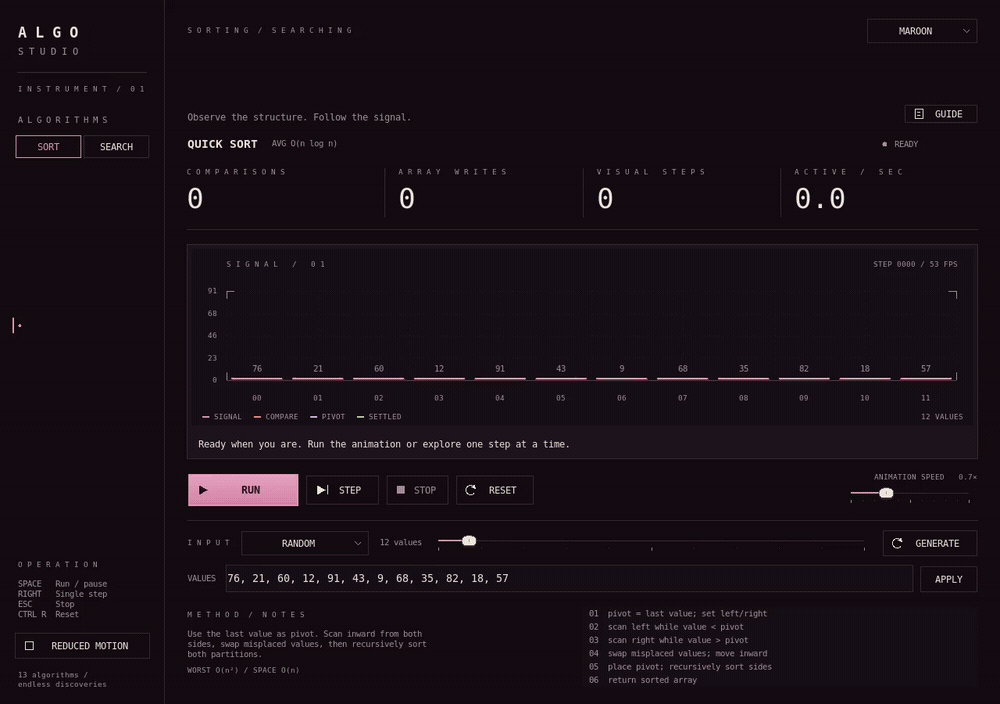

# Algo Studio · console preview

[Watch the 60 FPS recording](demo.mp4?raw=1) · [Open the animated demo](demo.gif?raw=1) · [Browse the preview source](../../PROJECT.py)



The appearance selector now offers **System, Phosphor, Paper, Red, Maroon, and Purple**. The three new dark palettes combine tinted near-black surfaces with scarlet, wine, mulberry, and aubergine gradients. Signal columns carry the richer gradients; the main control uses a quieter variation. Slider handles are rounded, with a small grip and eased movement.

The title, fonts, spacing, layout, algorithms, playback engine, shortcuts, input controls, guides, and reduced-motion option are preserved from the console preview. Theme changes cross-fade while playback continues. The application uses only Python's standard library and Tkinter.

The recording shows launch animation, Quick Sort continuing through Maroon → Red → Purple, pause/resume and speed adjustment, the completion wave, Paper mode, a signed Binary Search input in Phosphor mode, reduced motion, and Reset.

| Theme | Full-size preview |
| --- | --- |
| Red | [Scarlet fading into wine](red.png) |
| Maroon | [Rose fading into mulberry](maroon.png) |
| Purple | [Mauve fading into aubergine](purple.png) |
| Paper | [Cream, ink, and amber](paper.png) |
| Phosphor | [Warm black and phosphor amber](phosphor.png) |

Local validation covers all 13 algorithms, playback and keyboard controls, retained canvas items, interrupted animation, every theme, dropdown focus, slider interaction, and reduced motion. The 64-column playback sample measured approximately **62 FPS**, with **931 scope items retained** throughout. A standalone Python bundle was also built and run locally.

To run this branch from a checkout:

```sh
python3 PROJECT.py
```

On Windows, use `py PROJECT.py`. Python 3.10 or newer, Tkinter, and a graphical desktop are required. To reproduce the footage on an X11 desktop with FFmpeg installed:

```sh
python3 tools/record_console_preview.py --output temp/oscilloscope-preview
```

This folder is for preview review on `preview/oscilloscope-console`. The repository README, its existing media, `main`, and published releases have not been changed by this work.
